  

Oi, eu sou o Matheus! 👋

Sou **Engenheiro de Software** e gosto de entender como as coisas funcionam por dentro: do banco de dados à tela que a pessoa vê. Curto o lado lógico do back-end tanto quanto o lado criativo do front-end e do UX, porque acho que software bom precisa dos dois.

Sou movido a anime, games e rock, e isso aparece em tudo que eu faço, inclusive neste perfil. Acredito que dá para ser técnico e ter personalidade ao mesmo tempo.
  

  

 

## 🧰 Loadout

**Subindo de nível →** 

## 📜 Quest log

| Tipo | Missão | Status |
|:--|:--|:--|
| ⚔️ **Main quest** | Primeira vaga como Dev Java Júnior (back-end) | `EM ANDAMENTO` |
| 🎨 **Side quest** | Dominar Front-End e UX (HTML/CSS/JS → React) | `EM TREINO` |
| 🧪 **Sempre ativo** | Estudar, postar o que aprendo e fazer commits | `LOOP INFINITO` |

## 📊 Estatísticas

 

